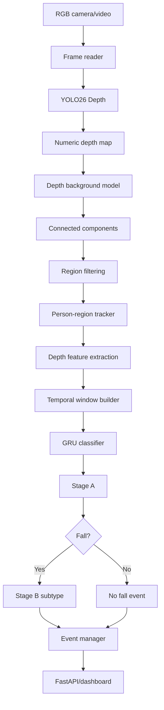

# System architecture

Depth estimation outputs a dense map, not person masks or IDs. The initial region extractor uses fixed-camera depth background subtraction; it may fail when people merge, stand still, or overlap furniture/stairs. Evaluate a segmentation alternative separately. If it uses RGB semantic features, document that the downstream representation is no longer strictly depth-only.

Offline research and online inference must share the same preprocessing and feature schema.
